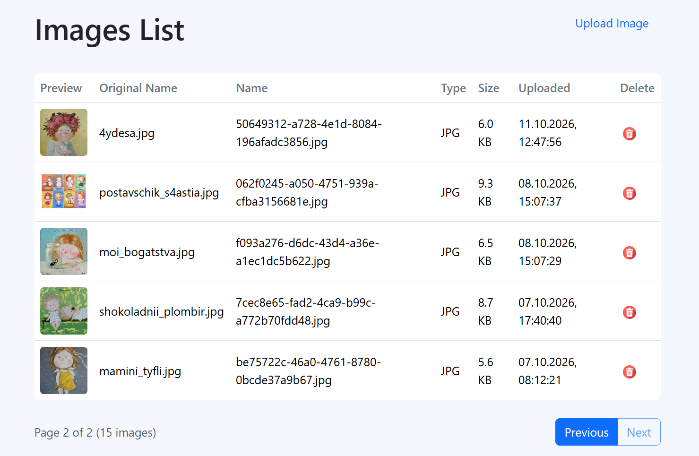

# 🖼️  Image Server


Image Server is a web application for uploading, storing, viewing, and managing images.

Users can upload supported image files and receive a link to access each image directly. The application stores image files separately from their metadata, while PostgreSQL keeps track of uploaded images and their properties.

Nginx serves uploaded images and forwards application requests to the Python backend. Docker simplifies application deployment, and persistent storage keeps uploaded files and logs available across container restarts.

---

## Table of Contents

- [Features](#features)
- [Tech Stack](#tech-stack)
- [Architecture](#architecture)
- [Getting Started](#getting-started)
- [Usage](#usage)
- [Image Metadata](#image-metadata)
- [Pagination](#pagination)
- [Database Backup and Restore](#database-backup-and-restore)
- [Logging](#logging)
- [Project Structure](#project-structure)
- [Error Handling](#error-handling)
- [Future Improvements](#future-improvements)

---

## Features

### Image Upload and Storage

- Upload JPG, PNG, and GIF images.
- Validate file extensions and enforce a maximum file size of 5 MB.
- Generate unique filenames to avoid filename collisions.
- Store uploaded images in persistent storage.
- Return a direct URL to each uploaded image.
- Serve uploaded images through Nginx.

### Web Interface

- Home page with navigation to the upload page.
- Image upload page with file selection and drag-and-drop support.
- Client-side file validation for immediate feedback.
- Image listing page displaying metadata in a table.
- Delete controls for uploaded images.
- Pagination controls for navigating through the image collection.

### Database Integration

- Store image metadata in PostgreSQL.
- Keep track of generated filenames and original filenames.
- Record file sizes, upload timestamps, and file types.
- Display the newest uploaded images first.
- Delete image metadata and the corresponding physical file.

### Pagination

- Display up to 10 images per page.
- Use SQL `LIMIT` and `OFFSET` to retrieve the requested page.
- Navigate between pages using Previous and Next controls.
- Disable navigation when there are no more pages in that direction.

### Infrastructure and Reliability

- Run the application using Docker and Docker Compose.
- Use a multi-stage Docker build for the Python backend.
- Use Nginx as a web server and reverse proxy.
- Keep uploaded images and logs in persistent Docker volumes.
- Log application operations and errors.
- Provide a script for creating timestamped PostgreSQL backups.

---

## Tech Stack

| Technology | Purpose                                                           |
|---|-------------------------------------------------------------------|
| **Python 3.12** | Backend and HTTP request handling using `http.server`             |
| **PostgreSQL 17** | Persistent storage of image metadata                              |
| **psycopg2** | Connecting the Python backend to PostgreSQL                       |
| **Nginx** | Reverse proxy and image delivery                                  |
| **Docker** | Containerizing the application                                    |
| **Docker Compose** | Running and managing application services                         |
| **Bootstrap 5** | Responsive web interface                                          |
| **HTML5 / CSS3** | Page structure and styling                                        |
| **JavaScript** | File upload interactions, image listing, deletion, and pagination |
| **Pillow** | Image-related processing support                                  |
| **python-dotenv** | Environment variable management by the application                |
 

---

## Architecture

The application runs as three Docker Compose services:

```text
                 Web Browser
                      |
                      v
                 Nginx :8080
                 /          \
                v            v
       Static Images     Python Backend :8000
                              |
                              v
                         PostgreSQL
```

| Service | Description |
|---|---|
| `app` | Python HTTP server that handles uploads, image management, database operations, and application logging |
| `db` | PostgreSQL 17 database that stores image metadata |
| `nginx` | Reverse proxy that serves uploaded images and forwards application requests to the backend |

### Request Flow

1. The browser sends requests to Nginx on port `8080`.
2. Nginx serves uploaded images directly from the shared images volume.
3. Other application requests are forwarded to the Python backend.
4. The backend validates uploads, manages image files, and communicates with PostgreSQL.
5. PostgreSQL stores image metadata, while image files remain in persistent file storage.

### Docker Volumes

| Volume | Purpose |
|---|---|
| `images` | Stores uploaded image files shared between the backend and Nginx |
| `logs` | Persists application logs |
| `postgres_data` | Persists PostgreSQL database files |

The database is accessible to the application through the internal Docker network using the hostname `db`. Nginx forwards application requests to the backend service.

The backend is exposed on port `8000` for development and debugging, while Nginx is exposed on port `8080` for browser access.

---

## Getting Started

### Prerequisites

Install the following tools:

- [Git](https://git-scm.com/)
- [Python 3.12 or newer](https://www.python.org/downloads/)
- [Docker Desktop](https://www.docker.com/products/docker-desktop/) with Docker Compose

### 1. Clone the Repository

```bash
git clone https://github.com/Olli4ka/image_server.git
cd image_server
```

### 2. Start the Application

Build the image and start the services:

```bash
docker compose up --build
```

To run the application in detached mode:

```bash
docker compose up --build -d
```

### 3. Open the Application

| Component               | URL                               |
|-------------------------|-----------------------------------|
| Home page               | http://localhost:8080/            |
| Upload page             | http://localhost:8080/upload      |
| Image listing           | http://localhost:8080/images      |
| API - image list (JSON) | http://localhost:8080/images-list |

To view application logs:

```bash
docker compose logs -f app
```

To stop the services:

```bash
docker compose down
```

Persistent volumes are retained unless they are explicitly removed.

---

## Usage

### Upload an Image

1. Open the upload page.
2. Select an image or drag and drop it into the upload area.
3. Make sure the image uses a supported format and does not exceed 5 MB.
4. Submit the upload.
5. Copy the generated image URL and open it in a browser.

### Browse Uploaded Images

Open:

```text
http://localhost:8080/images
```

The table displays the stored images and their metadata, including the generated filename, original filename, file size, upload time, and file type.

### View an Image Directly

Uploaded images are available through URLs in the following format:

```text
http://localhost:8080/images/<filename>
```

Replace `<filename>` with the generated filename returned after uploading an image.

### Delete an Image

Use the Delete control in the image listing table. The application sends a deletion request to the backend, which removes the corresponding database record and physical image file.

The image list is refreshed after a successful deletion.

---

## Image Metadata

PostgreSQL stores metadata for every successfully uploaded image.

The `images` table contains the following fields:

| Field | Description |
|---|---|
| `id` | Unique database identifier |
| `filename` | Unique filename generated by the server |
| `original_name` | Original filename provided by the user |
| `size` | Image size in bytes |
| `upload_time` | Date and time of upload |
| `file_type` | Image file extension |

Image files are stored separately from their metadata. This separation allows the application to serve files efficiently while using PostgreSQL to organize and retrieve information about them.

---

## Pagination

The image listing is divided into pages containing up to 10 records.

The backend uses SQL `LIMIT` and `OFFSET` to retrieve the requested page. Images are ordered by upload time, with the newest uploads displayed first.

For example:

```sql
SELECT *
FROM images
ORDER BY upload_time DESC
LIMIT 10 OFFSET 10;
```
This query retrieves the second page when the page size is 10.

The interface provides Previous and Next controls and handles the first and last pages. If the database contains no images, the page should display an appropriate empty-state message.

---

## Database Backup and Restore

The project includes a Python script that creates timestamped PostgreSQL backups using `pg_dump`.

### Create a Backup

Make sure the Docker Compose services are running, then execute the script from the project root:

```bash
python backups/backup_database.py
```

The script creates a timestamped SQL backup in the `backups/` directory and records the operation in `backups/backup.log`. Backup results are also logged to the application log when the backend container is available.

Example directory contents:

```text
backups/
├── backup_2026-10-10_120000.sql
└── backup.log
```

### Restore Database Backup

To restore a PostgreSQL database from a backup, make sure the Docker containers are running and execute the command corresponding to your terminal.

**Bash (Linux/macOS/Git Bash):**

```bash
docker exec -i images-db psql -U postgres -d image_server < backups/backup_file.sql
```

**PowerShell (Windows):**

```powershell
Get-Content .\backups\backup_file.sql -Raw | docker exec -i images-db psql -U postgres -d image_server
```

**Note:** Run the command from the project root directory. Replace `backup_file.sql` with the name of your backup file.

**Important:** Restoring a backup can overwrite or conflict with existing database data. Make sure you have a backup of the current database before proceeding.

---

## Logging

The application records relevant events, including upload operations, deletion operations, and errors.

Logs help with troubleshooting and monitoring application behavior. The application log is stored in the configured log directory and is preserved using persistent storage.

The database backup script maintains its own log in `backups/backup.log`.

---

## Project Structure

```text
image_server/
├── app/
│   ├── app.py                  # Main HTTP server and request handlers
│   └── database.py              # PostgreSQL database operations
├── backups/
│   ├── backup.log               # Database backup operation logs
│   ├── backup_*.sql             # Generated PostgreSQL database backups
│   └── backup_database.py       # Database backup script
├── images/                      # Uploaded images storage
├── logs/
├── static/
│   ├── img/                     # Static images and UI icons
│   ├── js/                      # JavaScript files for frontend interactions
│   ├── images-list.html         # Uploaded images list and pagination page
│   ├── index.html               # Home page
│   └── upload.html              # Image upload page
├── .gitignore                   # Files and directories excluded from Git
├── docker-compose.yml           # Docker services and named volumes configuration
├── Dockerfile                   # Docker image build instructions for the application
├── nginx.conf                   # Nginx configuration for routing and image delivery
├── README.md                    # Project documentation
└── requirements.txt             # Python project dependencies
```

---

## Error Handling

The application validates uploaded files and rejects unsupported formats and oversized uploads.

It also handles common operational errors, such as invalid requests, missing images, database errors, and failures during file operations. Relevant failures are recorded in the logs to support debugging.

---

## Future Improvements

Potential future enhancements include:

- Automated tests for upload, listing, pagination, and deletion.
- Scheduled database backups.
- Improved monitoring and operational metrics.
- Additional image processing features.

---

👩🏻‍💻 Developed as a Python backend and Docker learning project.
